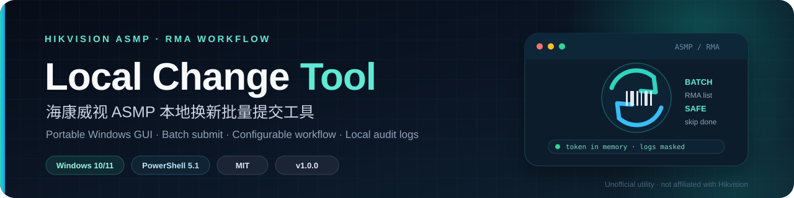
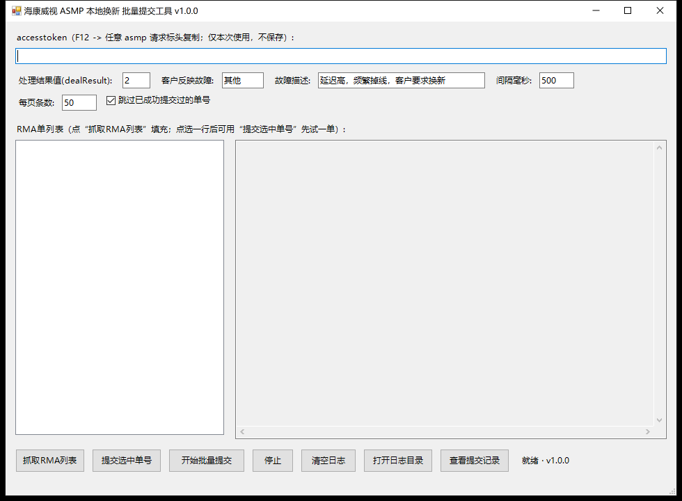
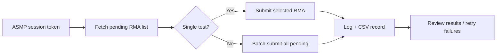

<p align="center">
  
</p>

<h1 align="center">Hikvision ASMP Local Change Tool</h1>

<p align="center">
  A portable Windows GUI for batch-submitting RMA local-change requests to Hikvision ASMP.
</p>

<p align="center">
  <a href="https://github.com/szrd2026/hikvision-asmp-localchange/releases/latest"></a>
  <a href="LICENSE"></a>
  
  
</p>

> **Unofficial utility.** This project is not affiliated with, endorsed by, or
> supported by Hikvision. Use it only with accounts and systems you are
> authorized to operate, and comply with the applicable service terms.

## Overview

**Hikvision ASMP Local Change Tool** is a small, self-contained Windows desktop
utility for service teams that process RMA local-change cases in the Hikvision
ASMP web portal. It retrieves pending RMA records, loads each record's detail,
applies the configured handling result and fault description, and submits the
local-change request through the same web API used by the portal.

It is designed for repetitive back-office work: preview one RMA first, then run
the remaining records in a controlled batch with a configurable delay, duplicate
protection and a local audit trail.



## Features

- **RMA list retrieval** with automatic pagination.
- **Single-record test submission** before committing to a batch.
- **Batch submission** with progress, stop control and a configurable interval.
- **Configurable workflow fields**: `dealResult`, fault type, fault description,
  page size and request delay.
- **Duplicate protection**: previously successful RMA IDs are skipped using a
  local CSV record.
- **Live log panel** plus one UTF-8 log file per run under `logs/`.
- **Token hygiene**: the ASMP `accesstoken` stays in memory, is never written to
  the configuration file, and is masked in logs.
- **Portable**: no installer, no admin rights, no external runtime. Windows 10/11
  ships with the required Windows PowerShell 5.1.
- **Reproducible packaging**: `build.ps1` produces a single-file x64 executable
  and a SHA-256 checksum.

## How it works



The tool calls three ASMP web endpoints:

| Step | Endpoint | Purpose |
| --- | --- | --- |
| 1 | `rmaManage/pageRmaList` | Retrieve pending RMA records |
| 2 | `rmaManage/getRmaDetailListPage` | Load the detail payload for one RMA |
| 3 | `loaclChange/localChangeNewProduct` | Submit the local-change request |

> The endpoint spelling `loaclChange` follows the ASMP web application. These
> are undocumented internal endpoints and may change without notice.

## Requirements

- Windows 10 or Windows 11, x64.
- Windows PowerShell 5.1 (included with Windows 10/11).
- Network access to `https://asmp.hikvision.com`.
- A valid ASMP account with permission to view and process RMA local-change
  records.
- A writable application folder (for example `Documents\Tools\`). Do **not** put
  the executable in `Program Files` unless you run it with write access.

## Installation

### Option A — release executable (recommended)

1. Open the [latest release](https://github.com/szrd2026/hikvision-asmp-localchange/releases/latest).
2. Download `Hikvision-LocalChange-v1.0.0-win64.exe`.
3. Download `checksums.txt` and verify the SHA-256 hash (optional but recommended).
4. Put the executable in a writable folder.
5. Double-click it. No installation is required.

### Option B — run from source

1. Clone the repository or download the source ZIP.
2. Double-click `Start-LocalChange.bat`.
3. The script runs with Windows PowerShell and opens the same GUI.

The source launcher is useful if your organization blocks unsigned executables
or if you want to inspect the code before running it.

## Usage

1. Sign in to the ASMP web portal in a browser.
2. Open DevTools with `F12`, go to **Network**, select any ASMP request and copy
   the `accesstoken` value from the request headers.
3. Paste the token into the tool. It is kept in memory for this run only.
4. Click **抓取RMA列表** / **Fetch RMA list**.
5. Select one row and click **提交选中单号** / **Submit selected** to test a
   single record.
6. Review the log. If the test succeeds, click **开始批量提交** / **Start batch**.
7. Check `localchange_records.csv` and the `logs\` folder for the result.

The tool only processes records matching the portal's pending local-change
filters (`rmaState=1`, `rmaDetailState=10`). If the list is empty, confirm that
the account has visible pending records and that the token is still valid.

### Configuration

The first time settings are saved, the tool creates `localchange_config.json`
next to the executable. Use [`config.example.json`](config.example.json) as a
reference. The `accesstoken` is deliberately **not** stored.

| Key | Default | Description |
| --- | --- | --- |
| `dealResult` | `"2"` | Handling result value sent to ASMP; must match your workflow. |
| `rebackFault` | `"其他"` | Fault category shown on the RMA. |
| `rebackFaulttext` | customer-specific | Free-text fault description. |
| `delay` | `"500"` | Delay between submissions, in milliseconds. |
| `pageSize` | `"50"` | RMA list page size. |
| `skip` | `true` | Skip RMA IDs previously recorded as successful. |

Runtime files are created beside the executable:

- `localchange_config.json` — non-secret settings.
- `localchange_records.csv` — submission history used for duplicate protection.
- `logs\localchange_YYYYMMDD_HHMMSS.log` — full request/response log for the run.

## Build from source

### Run the PowerShell GUI directly

```powershell
powershell -NoProfile -ExecutionPolicy Bypass -STA -File .\LocalChangeTool.ps1
```

### Build the Windows executable

Building requires PowerShell 7+ (recommended) or Windows PowerShell 5.1, plus
internet access to install the `ps2exe` module. The resulting executable runs on
the built-in Windows PowerShell 5.1 that ships with Windows 10/11.

PowerShell 7+:

```powershell
Install-PSResource ps2exe -Scope CurrentUser
.\build.ps1 -Version 1.0.0
```

Windows PowerShell 5.1:

```powershell
Install-Module ps2exe -Scope CurrentUser -Force
powershell -NoProfile -ExecutionPolicy Bypass -File .\build.ps1 -Version 1.0.0
```

`build.ps1` produces:

```text
dist\Hikvision-LocalChange-v1.0.0-win64.exe
dist\checksums.txt
```

The build uses `ps2exe` to embed the PowerShell GUI into a single x64 Windows
executable. The result still relies on the Windows PowerShell runtime that ships
with Windows 10/11; it is not a native compiled application.

To verify a downloaded build:

```powershell
Get-FileHash .\Hikvision-LocalChange-v1.0.0-win64.exe -Algorithm SHA256
Get-Content .\checksums.txt
```

## FAQ

### Windows SmartScreen says "Unknown publisher"

The executable is not code-signed. This is expected for a small open-source
utility. Check the SHA-256 against `checksums.txt`, then choose **More info** →
**Run anyway**. If your organization requires signed binaries, run the source
version through `Start-LocalChange.bat` or sign the executable with your own
certificate.

### The tool reports `notLogin` or the token is rejected

The `accesstoken` is a short-lived session credential. Sign in to ASMP again,
copy a fresh value from a current request, and retry. Signing out of the portal
invalidates the old session.

### The RMA list is empty

Confirm that the account can see pending local-change records in the portal and
that the records match the tool's filters. Also check the log for the raw API
response and error code.

### Settings or logs are not created

The application folder is not writable. Move the executable to a folder under
your user profile, such as `Documents\Tools\HikvisionLocalChange\`.

### Antivirus flags the executable

PowerShell-to-EXE packers are sometimes flagged heuristically. Verify the
checksum, review the source, or use `Start-LocalChange.bat` instead. Do not run a
copy from an untrusted source.

### Does the tool upload data anywhere else?

No. Requests go only to `https://asmp.hikvision.com`. There is no telemetry,
analytics or auto-update service.

## Security and privacy

- The token is held in memory only and is not persisted by this version.
- Logs mask the token, but they still contain full API payloads, serial numbers
  and customer information. Treat them as business-confidential data.
- `localchange_config.json`, `localchange_records.csv`, `logs/` and build output
  are excluded from Git. Never commit them.
- Use a dedicated account with the minimum required permissions where possible.
- See [SECURITY.md](SECURITY.md) for vulnerability reporting.

## License

Released under the [MIT License](LICENSE). Copyright (c) 2026 szrd2026.

---

## 中文说明

**海康威视 ASMP 本地换新批量提交工具** 是一个免安装的 Windows 桌面小工具，
用于在 ASMP 网页端批量处理 RMA 本地换新单：拉取待处理列表、读取每单详情、
填入处理结果与故障描述，再调用网页端同一接口提交。

> 本工具为个人/第三方工具，与海康威视无隶属或背书关系。请仅用于你本人有权
> 操作的账号与数据，并遵守相关服务条款。

### 主要功能

- 自动翻页拉取待处理 RMA 列表。
- 先提交单条测试，再批量提交，降低误操作风险。
- 可配置处理结果 `dealResult`、故障类型、故障描述、请求间隔和分页大小。
- 通过本地 CSV 记录跳过此前已成功的单号，避免重复提交。
- 界面实时日志；每次运行在 `logs\` 下保存独立日志。
- `accesstoken` 仅保存在内存中，不写入配置文件；日志中只显示打码值。
- 提供源码启动方式（`Start-LocalChange.bat`）和单文件 exe 发布版。

### 运行要求

- Windows 10 / Windows 11，64 位。
- 系统自带的 Windows PowerShell 5.1。
- 可访问 `https://asmp.hikvision.com`。
- 有效的 ASMP 账号、相应 RMA 权限和未过期的 `accesstoken`。
- 程序目录必须有写入权限（建议放在 `文档\Tools\` 等用户目录）。

### 快速使用

1. 在浏览器登录 ASMP 网页端。
2. 按 `F12` 打开开发者工具，进入“网络 / Network”，任选一个 ASMP 请求，
   从请求头中复制 `accesstoken`。
3. 粘贴到工具顶部输入框（仅本次运行使用）。
4. 点击“抓取RMA列表”。
5. 选中一行，点击“提交选中单号”先测试一单。
6. 确认日志显示成功后，点击“开始批量提交”。
7. 在 `localchange_records.csv` 和 `logs\` 中查看结果。

### 配置说明

首次保存设置后，程序会在 exe 同目录生成 `localchange_config.json`。可参考
[`config.example.json`](config.example.json)。`accesstoken` 不会写入该文件。

| 配置项 | 默认值 | 说明 |
| --- | --- | --- |
| `dealResult` | `"2"` | 处理结果值，需与业务流程一致。 |
| `rebackFault` | `"其他"` | 故障类型。 |
| `rebackFaulttext` | 按需填写 | 故障描述。 |
| `delay` | `"500"` | 每单之间的间隔（毫秒）。 |
| `pageSize` | `"50"` | 列表分页大小。 |
| `skip` | `true` | 跳过记录中已成功的单号。 |

### 从源码构建

直接运行源码：

```powershell
powershell -NoProfile -ExecutionPolicy Bypass -STA -File .\LocalChangeTool.ps1
```

构建单文件 exe（构建机需要 PowerShell 7+ 或 Windows PowerShell 5.1，并需要联网
安装 `ps2exe`；生成物在 Windows 10/11 自带的 PowerShell 5.1 上运行）：

```powershell
# PowerShell 7+
Install-PSResource ps2exe -Scope CurrentUser
.\build.ps1 -Version 1.0.0

# 或 Windows PowerShell 5.1
Install-Module ps2exe -Scope CurrentUser -Force
powershell -NoProfile -ExecutionPolicy Bypass -File .\build.ps1 -Version 1.0.0
```

输出位于 `dist\`，同时生成 `checksums.txt`。发布版 exe 未签名，Windows
SmartScreen 可能提示“未知发布者”，这属于未签名程序的正常现象；请先核对
SHA-256，再选择“更多信息 → 仍要运行”。如单位禁止运行未签名 exe，可直接
使用 `Start-LocalChange.bat` 运行源码。

### 安全提示

- 日志包含完整接口请求/响应、序列号和客户信息，请按业务敏感数据保管。
- 不要提交 `localchange_config.json`、`localchange_records.csv`、`logs/`。
- 如果 token 曾出现在截图、日志或聊天记录中，请退出 ASMP 使旧会话失效，
  再重新复制新 token。
- 本工具不包含登录功能，也不会向海康威视以外的地址发送数据。

### 许可

本项目采用 [MIT License](LICENSE)，版权归属 szrd2026（2026）。
